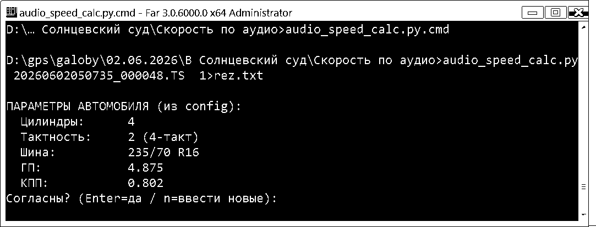
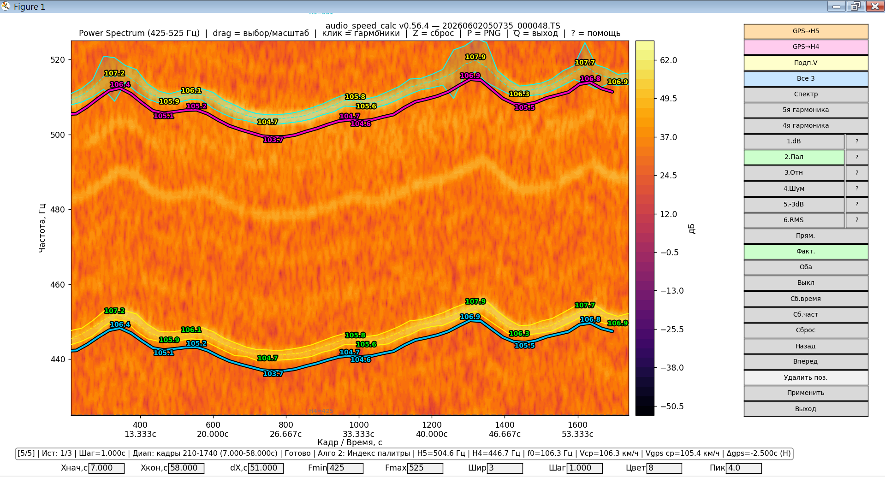

# audio_speed_calc

[](https://www.python.org/downloads/)
[]()
[]()
[](LICENSE)

**Определение скорости транспортного средства по звукозаписям видеорегистратора.**

Программа извлекает звук из `.ts`-фрагментов, строит спектрограмму,
выделяет гармонические составляющие шума двигателя и рассчитывает
скорость движения с учётом передаточных чисел КПП, главной передачи
и параметров шин. Результаты сопоставляются с GPS-данными
из того же файла.

Метод основан на публикации А.А. Годлевского (Челябинская ЛСЭ
Минюста России) и прошёл апробацию ведущими судебными экспертами
ФБУ Сибирский РЦСЭ и ФБУ Томская ЛСЭ Минюста России.

---

## Содержание

- [Возможности](#возможности)
- [Как это работает](#как-это-работает)
- [Требования](#требования)
- [Установка](#установка)
- [Быстрый старт](#быстрый-старт)
- [Работа с программой](#работа-с-программой)
- [Горячие клавиши](#горячие-клавиши)
- [Apply-модель истории](#apply-модель-истории)
- [Сборка .exe](#сборка-exe)
- [Конфигурация](#конфигурация)
- [Формулы](#формулы)
- [История версий](#история-версий)
- [Список литературы](#список-литературы)
- [Лицензия](#лицензия)

---

## Возможности

### Анализ звука

- **6 алгоритмов** выделения границ гармоник:
  `1.dB`, `2.Пал`, `3.Отн`, `4.Шум`, `5.-3dB`, `6.RMS`.
- Выбор 5-й и 4-й гармоник **кликом мыши** по спектрограмме.
- Расчёт мгновенной скорости по шагам с оценкой погрешности `±V`.
- Интерактивный зум, история переходов, сохранение позиций.

### GPS-сравнение

- Автоизвлечение GPS-меток из `.ts`:
  `exiftool -ee3` (при наличии) или встроенный бинарный парсер.
- Автоматический поиск запаздывания GPS методом кросс-корреляции.
- Калибровка dGPS по **самому длинному интервалу** из истории.
- Наложение GPS-скорости на спектрограмму в единицах Гц.

### Визуализация

- Спектрограмма в режимах `time` и `power`.
- Сетка гармоник, полосы H5/H4, линии min/max, «трубы» по шагам.
- Подписи пиков скорости и маркеры Vmax/Vmin.
- Экспорт PNG со штампом (версия, MD5, дата, имя файла).

### Отчёты

- `<file>_speed_report_algoN.txt` — пошаговый расчёт с формулами
  и подстановками, сведения о системе, диске, скрипте.
- `<file>_gps_lag_diag.log` — полный диагностический лог GPS-лага.
- `<file>_gps_lag_diag.csv` — то же в машиночитаемом виде.

---

## Как это работает

Двигатель внутреннего сгорания возбуждает акустические колебания
на частоте, пропорциональной оборотам коленвала. Микрофон
видеорегистратора надёжно фиксирует шум выпуска — наиболее
выраженную гармоническую составляющую.

Программа отслеживает положение 5-й и 4-й гармоник во времени,
вычисляет среднюю фундаментальную частоту и пересчитывает её
в скорость движения ТС.

Для **четырёхтактного** двигателя частота вращения:

```
n = 120 · f / k
```

где `k` — число цилиндров, `f` — частота рабочей гармоники.

Скорость движения:

```
V = 0,377 · r_k · n / (i₀ · i_k)
```

где `r_k` — радиус качения колеса, `i₀` — главная передача,
`i_k` — передаточное число включённой передачи.

Радиус качения определяется по маркировке шины:

```
r_k = 10⁻⁵ · λ · P · H + 0,0127 · R
```

где `λ` — коэффициент смятия, `P` — ширина, `H` — профиль,
`R` — посадочный диаметр.

---

## Требования

### Обязательные

- **Python** 3.8+ (проверено на 3.8.6 и 3.10–3.13)
- **ffmpeg** и **ffprobe** — извлечение аудио
- **numpy** ≥ 1.20
- **matplotlib** ≥ 3.4
- **tkinter** — диалоги (обычно входит в Python)

### Опциональные

- **exiftool** — извлечение GPS (есть встроенный fallback)
- **PyInstaller** — для сборки `.exe`

---

## Установка

### 1. Python-зависимости

```bash
pip install -r requirements.txt
```

Файл `requirements.txt`:

```
numpy>=1.20
matplotlib>=3.4
```

### 2. Внешние программы

**Windows:**

1. Скачайте `ffmpeg-release-essentials.zip` с
   [gyan.dev/ffmpeg/builds](https://www.gyan.dev/ffmpeg/builds/).
2. Распакуйте `ffmpeg.exe` и `ffprobe.exe` в папку `bin\`
   рядом со скриптом.
3. (Опционально) Скачайте `exiftool-XX.XX_64.zip` с
   [exiftool.org](https://exiftool.org/), распакуйте в ту же папку,
   переименуйте `exiftool(-k).exe` → `exiftool.exe`.

**Linux (Debian/Ubuntu):**

```bash
sudo apt install ffmpeg libimage-exiftool-perl python3-tk
```

**Linux (Fedora):**

```bash
sudo dnf install ffmpeg perl-Image-ExifTool python3-tkinter
```

**macOS (Homebrew):**

```bash
brew install ffmpeg exiftool python-tk
```

### 3. Проверка

Запустите на тестовом `.ts` — появится запрос параметров
автомобиля (см. рисунок 1).

---

## Быстрый старт

```bash
python audio_speed_calc.py путь/к/файлу.TS
```

Для сохранения всего текстового вывода в файл:

```bash
python audio_speed_calc.py путь/к/файлу.TS 1>rez.txt
```



*Рисунок 1. Консольный запрос параметров автомобиля при запуске.
Команда `1>rez.txt` перенаправляет вывод в файл.*

**Порядок работы:**

1. Программа извлечёт аудио и построит спектрограмму.
2. На запрос параметров нажмите `Enter` (согласиться
   с сохранёнными) или `n` (ввести новые).
3. Кликните по **5-й гармонике** (обычно 50–100 Гц).
4. Кликните по **4-й гармонике**.
5. Нажмите кнопку алгоритма (`1.dB` … `6.RMS`)
   или клавишу `1`–`6`.
6. Изучите результат в консоли и на графике.
7. Нажмите `A` («Применить»), чтобы зафиксировать
   состояние в истории.

---

## Работа с программой



*Рисунок 2. Главное окно после выполнения алгоритма «2.Пал —
Индекс палитры». Видны две жирные кривые — верхняя и нижняя
границы гармоник H5 и H4 с подписями мгновенной скорости.*

### Основные зоны окна

| Зона | Что показывает |
|------|----------------|
| Заголовок | Версия программы и имя текущего `.ts`-файла |
| Спектрограмма | Карта интенсивности звука: ось Y — частота (Гц), ось X — кадры и время |
| Colorbar | Шкала в дБ |
| Правая панель кнопок | Все команды управления |
| Статусная строка | Текущий шаг, история, диапазон, алгоритм, скорости |
| Нижняя строка ввода | Xнач, Xкон, dX, Fmin, Fmax, Шир, Шаг, Цвет, Пик |

### Разбор примера на рисунке 2

- Режим: **Power Spectrum** (кнопка «Спектр» в положении `power`).
- Диапазон анализа: кадры 210–1740 (7.000–58.000 с).
- Шаг расчёта: 1.000 с.
- Алгоритм: `2.Пал` — Индекс палитры.
- Гармоники: H5 = 504.6 Гц, H4 = 446.7 Гц.
- f₀ = 106.3 Гц.
- Vср = 106.3 км/ч, Vgps ср = 105.4 км/ч.
- Δgps = −2.500 с, маркер `(H)` — калибровка из истории.

### Кнопки управления

| Кнопка | Действие |
|--------|----------|
| `Спектр` | Переключение режима time/power |
| `5я` / `4я гармоника` | Режим выбора гармоник |
| `1.dB` … `6.RMS` | Запуск алгоритма |
| `GPS→H5` / `GPS→H4` | Наложение GPS-скорости |
| `Подп.V` | Подписи пиков скорости |
| `Все 3` | Включить/выключить все три верхние кнопки |
| `Прям.` / `Факт.` / `Оба` / `Выкл` | Режим оверлея |
| `Сб.время` / `Сб.част` / `Сброс` | Сброс осей |
| `Назад` / `Вперёд` | Навигация по истории |
| `Удалить поз.` | Удалить текущую позицию |
| `Применить` | Зафиксировать правки (Apply) |
| `Выход` | Закрыть окно |

---

## Горячие клавиши

| Клавиша | Действие |
|---------|----------|
| `A` | Применить правки (Apply) |
| `Z` | Шаг назад по истории |
| `Shift+Z` | Общий сброс |
| `S` | Сохранить конфиг + PNG |
| `P` | Сохранить только PNG |
| `Q` | Выход |
| `1`–`6` | Запуск алгоритма |
| `?` | Справка |
| `Esc` | Отмена / возврат в режим TIME |
| `Tab` / `Shift+Tab` | Поля ввода |

---

## Apply-модель истории

Программа использует **Apply-модель**: все изменения
накапливаются в памяти, в историю попадают **одной записью**
по явной команде.

- Маркер `Ист: N/M *` в статусной строке — есть неприменённые
  правки.
- Нажатие `A` или кнопки «Применить» — фиксация.
- При нажатии «Назад»/«Вперёд» с неприменёнными правками
  появляется диалог: **Да** (применить) / **Нет** (потерять) /
  **Отмена**.

Так история остаётся осмысленной: одна запись = одна законченная
рабочая позиция, а не серия микро-шагов.

---

## Сборка .exe

Для распространения без Python используйте PyInstaller.

### Установка PyInstaller

```bash
pip install pyinstaller
```

### Что положить в bin/

Перед сборкой поместите в папку `bin/`:

```
bin/
├── ffmpeg.exe
├── ffprobe.exe
└── exiftool.exe
```

### Сборка Windows

Двойной клик по `build_exe.bat` или из командной строки:

```bat
build_exe.bat
```

Результат: `dist\audio_speed_calc.exe`.

### Сборка Linux / macOS

```bash
chmod +x build_exe.sh
./build_exe.sh
```

Результат: `dist/audio_speed_calc`.

### Ручная сборка

```bash
pyinstaller audio_speed_calc.spec --clean --noconfirm
```

### Проверка

Запустите `.exe` на машине **без Python**. Если открывается
окно консоли с параметрами авто — сборка успешна.

Подробности — в [README_EXE.md](README_EXE.md).

---

## Конфигурация

Файл `<base>_config.json` создаётся автоматически рядом
с `.ts`-файлом. Ключевые поля:

| Поле | Назначение |
|------|------------|
| `harmonic_5_freq` / `harmonic_4_freq` | Частоты гармоник (Гц) |
| `time_step` | Шаг расчёта (с) |
| `color_steps` | Параметр алгоритма (1–255) |
| `peak_search_hz` | Полуширина поиска пика (Гц) |
| `algorithm` | Последний алгоритм (1–6) |
| `cylinders` | Число цилиндров |
| `stroke` | `2` = 4-такт, `1` = 2-такт |
| `tire_width` / `tire_profile` / `rim_diameter` | Параметры шины |
| `final_drive` / `gear_ratio` | Передаточные числа |
| `gps_lag_override` | Ручной лаг GPS (с) |
| `gps_lag_from_history` | Калибровка dGPS по истории (bool) |
| `gps_smooth_sec` | Окно сглаживания (с) |

Пример:

```json
{
  "cylinders": 4,
  "stroke": 2,
  "tire_width": 235,
  "tire_profile": 70,
  "rim_diameter": 16,
  "final_drive": 4.875,
  "gear_ratio": 0.802,
  "gps_lag_override": null,
  "gps_lag_from_history": true,
  "gps_smooth_sec": 2.0
}
```

---

## Формулы

**Частота вращения двигателя:**

```
n = 120 · f / k
```

**Скорость движения:**

```
V = 0,377 · r_k · n / (i₀ · i_k)
```

**Радиус качения колеса:**

```
r_k = 10⁻⁵ · λ · P · H + 0,0127 · R
```

**Отношение передаточных чисел при переключении:**

```
n_(K+1) / n_K = i_(K+1) / i_K
```

### Пример расчёта

Для автомобиля ВАЗ-21099 с шинами 175/80 R13 (i₀ = 3,94,
i₄ = 0,941) при частоте рабочей гармоники 75,5 Гц:

```
n = 120 · 75,5 / 4 = 2265 об/мин
r_k = 10⁻⁵ · 0,85 · 175 · 80 + 0,0127 · 13 = 0,277 м
V = 0,377 · 0,277 · 2265 / (3,94 · 0,941) = 77,4 км/ч
```

Результат совпадает со следственным экспериментом (78 км/ч).

---

## История версий

| Версия | Изменения |
|--------|-----------|
| **0.56.4** | Совместимость с PyInstaller, сборочные скрипты |
| **0.56.3** | Apply-модель истории, маркер неприменённых правок |
| **0.56.2** | Исправление навигации по истории |
| **0.56.1** | Калибровка dGPS по длинному интервалу |
| **0.56.0** | Убрано автосохранение, перехват кнопки-дискеты |
| **0.55.9** | Калибровка GPS-кривых по реальному треку |
| **0.55.3** | Выравнивание GPS-графика по шкале времени аудио |
| **0.55.2** | Критическое исправление знака GPS-лага |
| **0.55.0** | Обрезка краёв FFT, единое сглаживание |
| **0.54.0** | Поиск лага по окну анализа |
| **0.53.0** | Кнопка «Подп.V», калибровка GPS→H5/H4 |

Полный журнал — в [history_log.txt](history_log.txt).

---

## Список литературы

1. **Годлевский А.А.** Определение скорости транспортного
   средства по звукозаписям видеорегистратора // Теория
   и практика судебной экспертизы. 2016. № 4 (44). С. 66–72.
   DOI: 10.30764/1819-2785-2016-4-66-72.
   [tipse.ru/jour/article/view/11/0](https://www.tipse.ru/jour/article/view/11/0)

2. **Актуальные вопросы экспертизы видеозаписей**: материалы
   всероссийского семинара, Нижний Новгород, 13–17 мая 2013 г. /
   под ред. В.Н. Пронина, П.Г. Лесниковой. — Нижний Новгород,
   2014. — 406 с.

3. **Пучкин В.А.** Основы экспертного анализа
   дорожно-транспортных происшествий. — Ростов н/Д: ИПО ПИ ЮФУ,
   2010. — 400 с.

4. **Краткий автомобильный справочник НИИАТ**. — М.:
   АО «Трансконсалтинг», 1994. — 779 с.

5. **Селифонов В.В., Хусаинов А.Ш., Ломакин В.В.** Теория
   автомобиля: Учебное пособие. — М.: МГТУ «МАМИ», 2007. — 102 с.

6. **Власов О.О.** Методологические аспекты судебно-экспертного
   исследования видеозаписей // Теория и практика судебной
   экспертизы. 2025. Т. 20. № 3. С. 25–31.
   DOI: 10.30764/1819-2785-2025-3-25-31.
   [tipse.ru/jour/article/view/1121](https://www.tipse.ru/jour/article/view/1121)

7. **Передаточные числа КПП ВАЗ-21099** — Otoba.ru.
   [otoba.ru/transmissii/vaz/2109.html](https://otoba.ru/transmissii/vaz/2109.html)

8. **ExifTool Forum** — Extracting GPS Information from .MP4.
   [exiftool.org/forum/index.php?topic=13536.0](https://exiftool.org/forum/index.php?topic=13536.0)

---

## Лицензия

MIT License. См. файл [LICENSE](LICENSE).

---

## Файлы проекта

```
audio_speed_calc/
├── audio_speed_calc.py           # основной скрипт
├── sys_fingerprint.py            # MD5, инфо о ПК/диске
├── audio_speed_calc.spec         # спецификация PyInstaller
├── build_exe.bat                 # сборка .exe на Windows
├── build_exe.sh                  # сборка на Linux/macOS
├── requirements.txt              # Python-зависимости
├── README.md                     # этот файл
├── README_EXE.md                 # инструкция по сборке .exe
├── LICENSE                       # MIT
├── history_log.txt               # журнал версий
├── docs/
│   ├── 01_console_params.png     # рисунок 1
│   └── 02_gui_result.png         # рисунок 2
└── bin/                          # внешние бинарники
    ├── ffmpeg.exe
    ├── ffprobe.exe
    └── exiftool.exe
```

---

**Проверено на:** Windows 7 SP1, Windows 10, Linux (Debian 12),
macOS 13. Поддерживается Python 3.8+.
