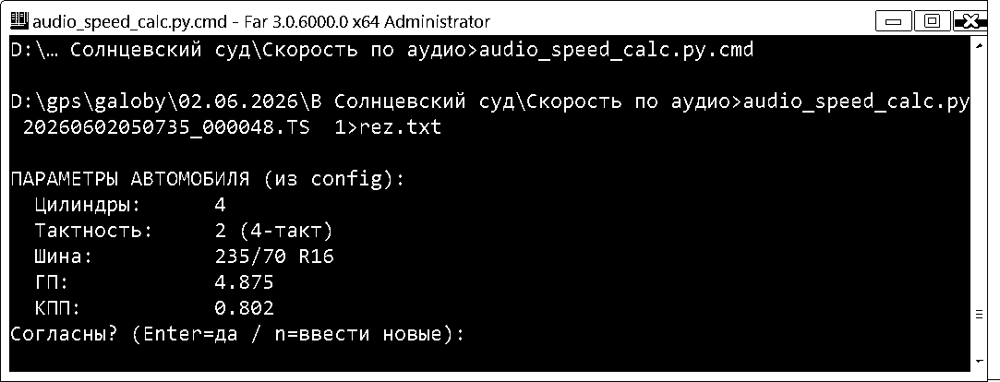
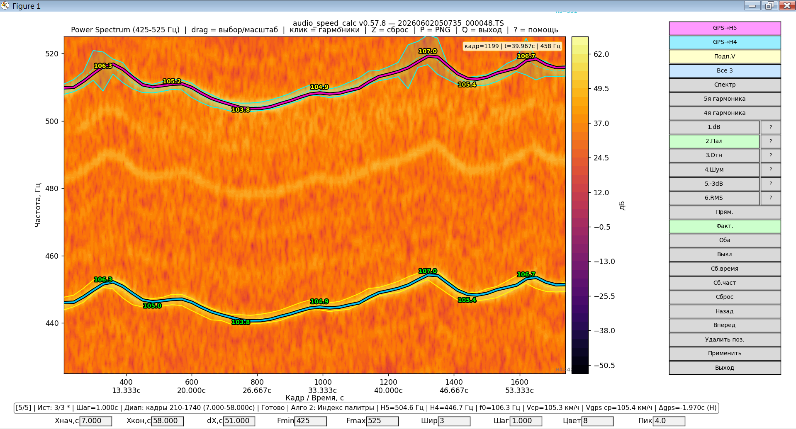

# audio_speed_calc v0.58.13

**Определение скорости транспортного средства по звукозаписям видеорегистратора**
*Методика и руководство пользователя*

* **Автор методики:** А.А. Годлевский (ФБУ Челябинская ЛСЭ Минюста России)
* **Версия документа:** 1.5 (обновлено под v0.58.13)

---

## Содержание
1. [Введение](#введение)
2. [Назначение и область применения](#назначение-и-область-применения)
3. [Теоретические основы метода](#теоретические-основы-метода)
4. [Требования к системе](#требования-к-системе)
5. [Установка](#установка)
6. [Быстрый старт](#быстрый-старт)
7. [Работа с программой](#работа-с-программой)
8. [Логика расчёта и формулы](#логика-расчёта-и-формулы)
9. [Настройка через JSON-конфиг](#настройка-через-json-конфиг)
10. [История версий](#история-версий)
11. [Список литературы](#список-литературы)
12. [Приложение А. Пример расчёта](#приложение-а-пример-расчёта)
13. [Приложение Б. Сведения об авторе](#приложение-б-сведения-об-авторе)

---

## Введение
Программа **audio_speed_calc** реализует методику определения скорости транспортного средства (ТС) по звукозаписям автомобильного видеорегистратора. Метод разработан в ФБУ Челябинская ЛСЭ Минюста России **А.А. Годлевским** и прошёл апробацию ведущими государственными судебными экспертами ФБУ Сибирский РЦСЭ и ФБУ Томская ЛСЭ Минюста России.

## Назначение и область применения

### Назначение
Программа предназначена для определения скорости движения ТС путём инструментального анализа звукового ряда видеофонограмм, полученных с автомобильных видеорегистраторов. Метод основан на выделении гармонических составляющих шума работающего двигателя внутреннего сгорания (ДВС) и последующем пересчёте частоты рабочего цикла двигателя в скорость движения ТС с учётом передаточных чисел трансмиссии и геометрических параметров шин.

### Ограничения
* Метод применим для ТС с **механической коробкой передач (МКПП)**. Для автоматических коробок (АКПП) требуется дополнительное определение номера включённой передачи.
* Точность зависит от качества звукозаписи и шумовой обстановки в салоне.
* Требуется знание передаточных чисел КПП и главной передачи, а также маркировки шин.
* Подписи пиков на графике рисуются с фильтром, предотвращающим их наложение. Пороги фильтра настраиваются (`label_pad_x_frac`, `label_pad_y_frac`).

## Теоретические основы метода

### Основные формулы
Частота вращения двигателя (об/мин):
**n = 60 · f · (2 / k) = 120 · f / k** (1)
где *n* — частота вращения коленчатого вала, об/мин; *f* — частота рабочего цикла двигателя (гармоники), Гц; *k* — количество цилиндров (для четырёхтактного двигателя); 2 — количество оборотов коленчатого вала за один рабочий цикл.

Средняя скорость движения ТС (км/ч):
**V = 3,6 · S_k / T** (2)
где *S_k* — путь, пройденный колесом за один оборот, м; *T* — период вращения колеса, с.

Путь, пройденный колесом за один оборот:
**S_k = 2 · π · r_k** (3)

Период вращения колеса:
**T = 60 · i₀ · i_k / n** (4)
где *i₀* — передаточное число главной передачи; *i_k* — передаточное число включённой передачи КПП.

Итоговая скорость (км/ч):
**V = 0,377 · r_k · n / (i₀ · i_k)** (5)

Радиус качения колеса (м):
**r_k = 10⁻⁵ · λ · P · H + 0,0127 · R** (6)
где λ — коэффициент смятия шины (`tire_deflection_coeff`); *P* — ширина протектора шины, мм; *H* — профиль шины (высота в % от ширины); *R* — посадочный диаметр, дюймы.

## Требования к системе
* **Python** 3.8+
* **ffmpeg** и **ffprobe** (извлечение аудио, определение длительности)
* **numpy** >= 1.20
* **matplotlib** >= 3.4
* **sys_fingerprint.py** (в комплекте)
* *Опционально:* exiftool, tkinter

## Установка
```bash
pip install -r requirements.txt
```
Содержимое `requirements.txt`:
```text
numpy>=1.20
matplotlib>=3.4
```
Для Windows скачайте `ffmpeg.exe` и `ffprobe.exe` с gyan.dev и положите в папку `bin/` рядом со скриптом.


*Рис. 1. Консольный запрос параметров автомобиля при запуске программы. Команда `1>rez.txt` перенаправляет весь текстовый вывод в файл `rez.txt`.*

## Быстрый старт
```bash
python audio_speed_calc.py path/to/file.TS
```
С сохранением всего текстового вывода в файл:
```bash
python audio_speed_calc.py path/to/file.TS 1>rez.txt
```
1. Программа извлечёт аудио и построит спектрограмму.
2. Нажмите **Enter** (согласиться с параметрами авто) или **n** (ввести новые).
3. В окне кликните мышью по **5-й гармонике** (H5), затем по **4-й гармонике** (H4).
   *Для 4-цилиндрового 4-тактного: при 3000 об/мин H5 ≈ 500 Гц, H4 ≈ 400 Гц.*
4. Нажмите кнопку алгоритма или клавишу **1–6**.
5. Нажмите **A** («Применить»), чтобы зафиксировать результат.

## Работа с программой


*Рис. 2. Главное окно после выполнения алгоритма «2.Пал — Индекс палитры». Две жирные кривые — верхняя и нижняя границы гармоник (H5 и H4), с подписями мгновенной скорости. Справа — панель кнопок управления, внизу — поля ввода и статусная строка.*

### Горячие клавиши
| Клавиша | Действие |
| :--- | :--- |
| `A` | Применить правки (Apply) |
| `Z` | Шаг назад по истории |
| `Shift+Z` | Общий сброс |
| `Home` | Перейти к первой позиции истории |
| `End` | Перейти к последней позиции истории |
| `Ctrl+1..9`, `Ctrl+0` | Быстрый прыжок на позицию 1..9 или 10 |
| `S` | Сохранить конфиг + PNG + отчёт |
| `P` | Сохранить PNG со штампом |
| `Q` | Выход |
| `1–6` | Запуск алгоритма |
| `?` | Справка |
| `Tab` / `Shift+Tab` | Переключение полей ввода |
| `Esc` | Снять фокус с поля ввода |

### Apply-модель истории
* Все изменения копятся в памяти.
* История не пополняется автоматически.
* Фиксация — кнопка **«Применить»** или клавиша **A**.
* Индикатор `Ист: N/M *` — есть неприменённые правки.
* При переходах по истории с правками — диалог Да/Нет/Отмена.

### Подписи пиков
| Источник | Цвет |
| :--- | :--- |
| GPS-H5 | маджента `#ff00cc` |
| GPS-H4 | голубая `#00ccff` |
| Реальный трек H5 | жёлтый `#ffff00` |
| Реальный трек H4 | зелёный `#00ff00` |

## Логика расчёта и формулы
1. Извлечение аудио из .ts-файла через `ffmpeg`.
2. Построение спектрограммы (БПФ, окно Ханна, fft_size 32768).
3. Выбор гармоник H5 и H4 кликом мыши.
4. Отслеживание гармоник по кадрам (rolling-трекинг пика).
5. Расчёт частоты f = (f5/5 + f4/4) / 2.
6. Расчёт оборотов n = 60 · f · stroke / cylinders.
7. Расчёт скорости V = 0,377 · rk · n / (i0 · ik).

### Алгоритмы выделения границ
| Алгоритм | Метод |
| :--- | :--- |
| 1.dB | Абсолютный порог в dB |
| 2.Пал | Индекс палитры |
| 3.Отн | Относительный от пика |
| 4.Шум | Адаптивный от шума |
| 5.-3dB | Половинная мощность |
| 6.RMS | RMS-интегрирование |

## Настройка через JSON-конфиг
Файл конфига лежит рядом с `.ts` и называется `<base_ts>_config.json`. 
**Как записать конфиг на диск:** Только клавиша **S** в окне программы. Кнопка «Выход» и закрытие окна конфиг не пишут.

### Параметры автомобиля
| Параметр | Дефолт | Что делает / Когда менять |
| :--- | :--- | :--- |
| `cylinders` | 4 | Количество цилиндров |
| `stroke` | 2 | Тактность: 1 — 2-тактный, 2 — 4-тактный |
| `tire_width` | 235 | Ширина протектора, мм |
| `tire_profile` | 70 | Профиль шины, % |
| `rim_diameter` | 16 | Посадочный диаметр, дюймы |
| `final_drive` | 4.875 | Передаточное число главной передачи |
| `gear_ratio` | 0.802 | Передаточное число включённой передачи |
| `tire_deflection_coeff` | 0.84 | Коэф. смятия шины (главный параметр подстройки под GPS) |

### Параметры GPS и времени MSK
| Параметр | Дефолт | Что делает / Когда менять |
| :--- | :--- | :--- |
| `gps_lag_override` | null | Принудительный dGPS-сдвиг, секунды (если авто-калибровка не справляется) |
| `gps_trim_fft_edges` | true | Обрезать края FFT перед корреляцией |
| `gps_smooth_sec` | 2.0 | Окно сглаживания сигналов перед корреляцией |
| `ssa_time_correction_sec` | 0.0 | Поправка времени MSK **ТОЛЬКО для файлов .ssa**. На спектрограмму не влияет. |
| `full_ssa_shift_sec` | 0.0 | Сдвиг времени полного .ssa (не фрагмента) |
| `ssa_add_audio_speed` | true | Вписывать аудио-скорость в .ssa (Make Disk) |

### Добор GPS из соседних файлов
| Параметр | Дефолт | Что делает / Когда менять |
| :--- | :--- | :--- |
| `neighbor_gps_enabled` | true | Добирать GPS из N−1 и N+1 .ts |
| `neighbor_extend_sec` | 30.0 | На сколько секунд подтягивать соседей |
| `doubt_zones_enabled` | true | Включить анализ скачков ускорения |
| `doubt_min_points` | 15 | Минимум валидных точек для корреляции |

### Типовые ситуации «симптом → параметр»
* **Скорости завышены/занижены:** Правьте `tire_deflection_coeff` по формуле `c_new = c_old * (1 - k/100)`, где k — расхождение в %.
* **Программа не находит гармоники:** Проверьте `freq_min` / `freq_max`. Увеличьте `peak_search_hz` до 10–15, если гармоника дрейфует.
* **Подписи налезают:** Увеличьте `label_pad_x_frac` до 0.12–0.15 или `label_pad_y_frac` до 0.08.
* **dGPS явно неверный:** Задайте `gps_lag_override` вручную (например, `1.5` или `-2.0`).

## История версий
| Версия | Изменения |
| :--- | :--- |
| **0.58.13** | Убрано влияние `ssa_time_correction_sec` на спектрограмму; добавлены быстрые переходы по истории (Home/End/Ctrl+1..9); исправлено чтение базового времени MSK. |
| **0.58.0** | Ввод ручного сдвига ΔGPS в GUI; `start_maximized`. |
| **0.57.9** | Фильтр X+Y для подписей пиков; `label_pad_x_frac` / `label_pad_y_frac`. |
| **0.57.8** | Коэффициент смятия шины `tire_deflection_coeff` вынесен в конфиг. |
| **0.57.7** | Восстановлена history-калибровка dGPS. |
| **0.57.6** | Критерий поиска dGPS: минимум RMSE. |
| **0.56.5** | GPS из соседних файлов, зоны недоверия, валидация точек. |
| **0.53.0** | Кнопка «Подп.V», калибровка GPS→H5/H4. |

## Список литературы
1. **Годлевский А.А.** Определение скорости транспортного средства по звукозаписям видеорегистратора // Теория и практика судебной экспертизы. 2016. № 4 (44). С. 66–72. DOI: 10.30764/1819-2785-2016-4-66-72.
2. **Пучкин В.А.** Основы экспертного анализа дорожно-транспортных происшествий. — Ростов н/Д: ИПО ПИ ЮФУ, 2010. — 400 с.
3. **Власов О.О.** Методологические аспекты судебно-экспертного исследования видеозаписей // Теория и практика судебной экспертизы. 2025. Т. 20. № 3. С. 25–31.
4. *SAE Technical Paper 2023-01-0632.* Speed Determination Using Audio Analysis of Dash Camera Video.

## Приложение А. Пример расчёта
**Исходные данные:** Шины 235/70 R16; 4 цилиндра; i₀ = 4,875; i_k = 0,802; H5 = 504,6 Гц; H4 = 446,7 Гц.

1. **Частота рабочего цикла:**
   f5 = 504,6 / 5 = 100,92 Гц
   f4 = 446,7 / 4 = 111,68 Гц
   f = (100,92 + 111,68) / 2 = **106,3 Гц**
2. **Обороты:**
   n = 120 * 106,3 / 4 = **3189 об/мин**
3. **Радиус качения:**
   r_k = 10⁻⁵ * 0,84 * 235 * 70 + 0,0127 * 16 = **0,339 м**
4. **Скорость:**
   V = 0,377 * 0,339 * 3189 / (4,875 * 0,802) ≈ **104,3 км/ч**

*При c_def = 0,85 — 105,5 км/ч. Средняя по программе: 105,3 км/ч, по GPS: 105,4 км/ч. Расхождение < 1%.*

## Приложение Б. Сведения об авторе
**Годлевский Андрей Анатольевич**
Заведующий отделом информационно-технических, лингвистических и психологических экспертиз ФБУ Челябинская лаборатория судебной экспертизы Министерства юстиции Российской Федерации.
E-mail: chel_lse@mail.ru

*Апробация:* С.А. Кривощеков (ФБУ Сибирский РЦСЭ), Ю.А. Денисов (ФБУ Томская ЛСЭ).
